# PowerShellUniversal.Component.Chameleon

**Design MUI themes for PowerShell Universal apps visually, then let your users switch between them at runtime.**

Chameleon ships two custom PSU components and a ready-to-run app:

| | What it does |
|---|---|
| 🎨 **`New-UDThemeBuilder`** | A full theme editor: light and dark palettes, typography, shape, live preview, and one-click export to PowerShell or JSON. |
| 🖌️ **`New-UDThemePicker`** | A drop-in control that swaps the app's theme for the current user, instantly, without a page reload. |
| 🧰 **Chameleon app** | A ready-made PSU app (`/chameleon`) with the builder, a saved theme gallery, and a picker in the header. |

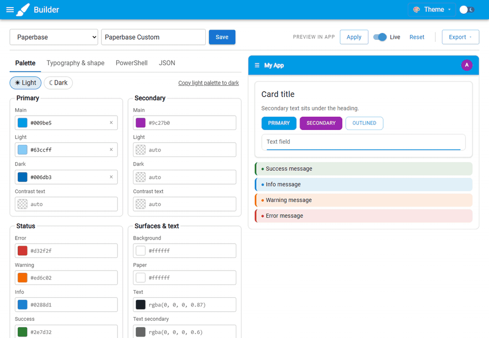

---

## Table of contents

- [Quick start](#quick-start)
- [The theme builder](#the-theme-builder)
  - [Start from an existing theme](#start-from-an-existing-theme)
  - [Edit the palette](#edit-the-palette)
  - [Light and dark modes](#light-and-dark-modes)
  - [Typography and shape](#typography-and-shape)
  - [Preview in the real app](#preview-in-the-real-app)
  - [Save and export](#save-and-export)
- [The theme picker](#the-theme-picker)
- [Using your theme in another app](#using-your-theme-in-another-app)
- [Saved Themes page](#saved-themes-page)
- [Command reference](#command-reference)
- [How it works](#how-it-works)
- [Building from source](#building-from-source)
- [Troubleshooting](#troubleshooting)

---

## Quick start

1. **Build the module** (requires Node.js and npm):

   ```powershell
   .\build.ps1
   ```

    The deployable module lands in `output\PowerShellUniversal.Component.Chameleon`.

2. **Install it** into your PSU repository:

   ```powershell
   $Copy = @{
    Path = '.\output\PowerShellUniversal.Component.Chameleon\*'
    Destination = 'C:\ProgramData\UniversalAutomation\Repository\Modules\PowerShellUniversal.Component.Chameleon'
       Recurse = $true
       Force = $true
   }
   Copy-Item @Copy
   ```

3. **Restart the Chameleon app** in the PSU admin console. The app is registered automatically from `.universal/dashboards.ps1` at **`/chameleon`**.

4. Open `https://<your-psu>/chameleon`, pick a starting point, and start designing.

> [!NOTE]
> The app is registered with `Authenticated = $false`. Anyone who can reach it can save and delete themes. Edit [PowerShellUniversal.Component.Chameleon/.universal/dashboards.ps1](PowerShellUniversal.Component.Chameleon/.universal/dashboards.ps1) and set `Authenticated = $true` (and a `Role`) before exposing it beyond your own machine.

---

## The theme builder

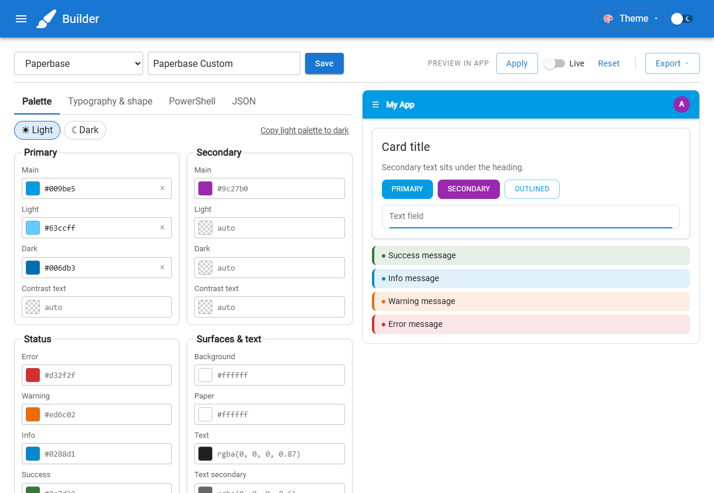

The builder has three areas:

- **Toolbar**: choose a starting theme, name it, save it, preview it in the app, and export it.
- **Editor** (left): tabs for **Palette**, **Typography & shape**, **PowerShell**, and **JSON**.
- **Preview** (right): a mock app (header bar, card, buttons, text field, alerts) that redraws on every keystroke.

Add it to any page:

```powershell
New-UDThemeBuilder -Id 'themeBuilder'
```

### Start from an existing theme

Use the **Start from** list to load a starting point into the editor. It offers:

- **Starter theme**: a clean indigo/pink theme.
- **Saved themes**: anything you've saved with the builder.
- **Built-in themes**: PSU's own MUI themes: `MaterialDesign`, `AntDesign`, `Paperbase`, `Sand`, and `Compliment`.

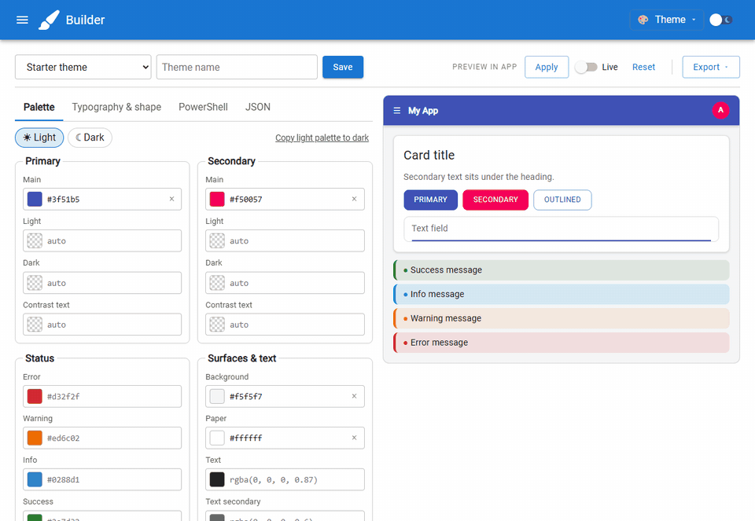

Loading a theme copies it into the editor and fills in a suggested name (for example, `Paperbase Custom`). Anything the editor doesn't have a field for, such as `overrides`, `mixins`, or per-variant typography, is preserved and included when you save or export.

> [!TIP]
> `Get-UDTheme` also lists ~290 terminal color schemes (Dracula, nord, and so on) that PSU converts on the fly. Those aren't hand-built MUI themes, so the builder doesn't offer them. You can still use them with the picker by name; see [The theme picker](#the-theme-picker).

### Edit the palette

Every color field has a swatch, a text box, and a **×** to reset it.

- **Click the swatch** to open your system color picker.
- **Type any CSS color** into the text box: `#5c9fd8`, `rgb(92, 159, 216)`, `rgba(0, 0, 0, 0.6)`, and so on.
- **Leave it empty** and MUI uses its default. Defaults appear as placeholder text; a checkerboard swatch means "MUI calculates it."

| Group | Fields | Tip |
|---|---|---|
| **Primary / Secondary** | Main, Light, Dark, Contrast text | You usually only need **Main**. MUI derives Light (20% lighter), Dark (30% darker), and a readable contrast text color automatically. |
| **Status** | Error, Warning, Info, Success | Used by alerts, chips, validation, and `New-UDButton -Color`. |
| **Surfaces & text** | Background, Paper, Text, Text secondary, Divider | **Background** is the page; **Paper** is cards, tables, and menus. |

> [!TIP]
> Working from a design system with a numbered scale (like Bootstrap's `$blue-300` / `$blue` / `$blue-700`)? Map those to **Light**, **Main**, and **Dark** to match your brand exactly instead of letting MUI derive them.

### Light and dark modes

Themes have independent **light** and **dark** palettes. Use the **☀ Light** / **☾ Dark** chips to switch which one you're editing; the preview switches with you.

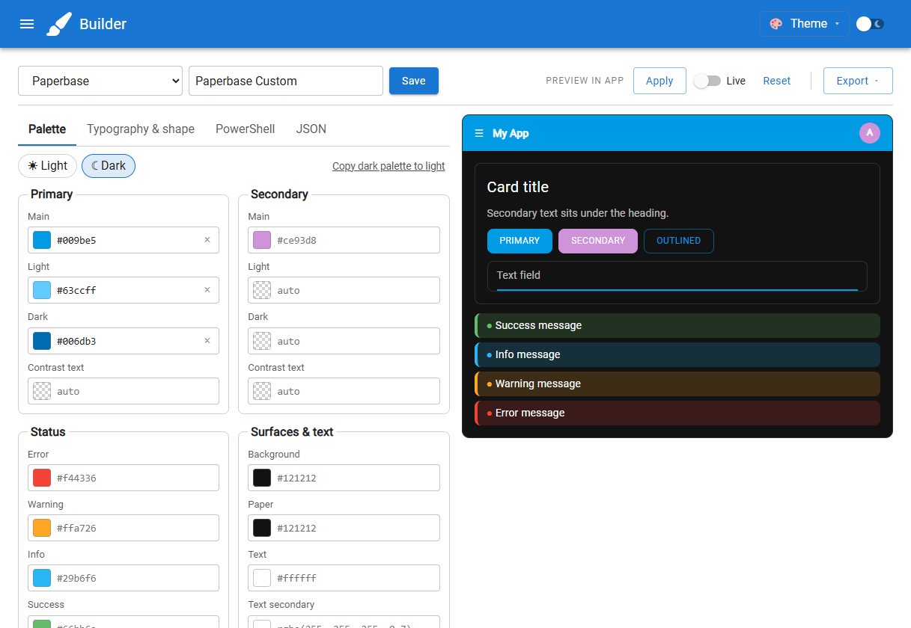

**Copy light palette to dark** (or the reverse) duplicates the current palette into the other mode as a starting point.

Users switch between modes with PSU's built-in toggle in the app header. The theme picker keeps whichever mode the user has chosen. The builder's **Apply** uses the mode you're editing, so you can check each palette on the real app.

### Typography and shape

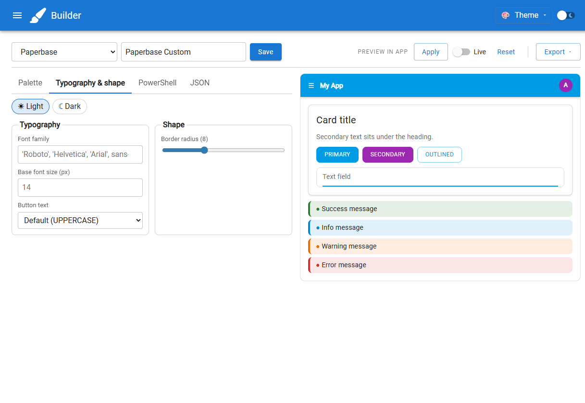

| Setting | Theme property | Notes |
|---|---|---|
| **Font family** | `typography.fontFamily` | Any CSS font stack. Suggestions are offered as you type. |
| **Base font size** | `typography.fontSize` | In pixels. MUI's default is 14. |
| **Button text** | `typography.button.textTransform` | Default (UPPERCASE), As typed, Capitalize, or lowercase. |
| **Border radius** | `shape.borderRadius` | Rounds buttons, cards, inputs, and menus. |

These settings apply to **both** light and dark modes so your app feels the same in either.

> [!IMPORTANT]
> Setting a font family doesn't download the font. If it isn't installed on your users' machines, load it in your app with `New-UDApp -Stylesheets`; see [Using your theme in another app](#using-your-theme-in-another-app).

### Preview in the real app

The mock preview is quick, but nothing beats seeing your theme on real components. The **Preview in app** controls apply the theme to the app you're using right now:

| Control | What it does |
|---|---|
| **Apply** | Applies the current theme to the app, in the mode you're editing (light or dark). |
| **Live** | Re-applies automatically ~0.5 seconds after every edit. Change a color and watch the header, buttons, and menus update. |
| **Reset** | Puts the app back to its own configured theme. |

Applied themes affect **only your browser**. Nobody else using the app sees your experiments.

### Save and export

**Save** stores the theme under the name in the name box. Saved themes appear immediately in **Start from**, the header picker, and the Saved Themes page. Saving with an existing name overwrites it. Names can contain letters, numbers, spaces, `-`, `_`, and `.` (up to 64 characters).

**Export** copies the theme to your clipboard:

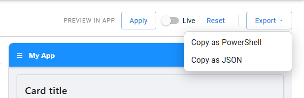

- **Copy as PowerShell** gives you a hashtable ready for `New-UDApp -Theme`.
- **Copy as JSON** gives you the raw theme for storage or sharing.

The **PowerShell** tab shows the same code inline:

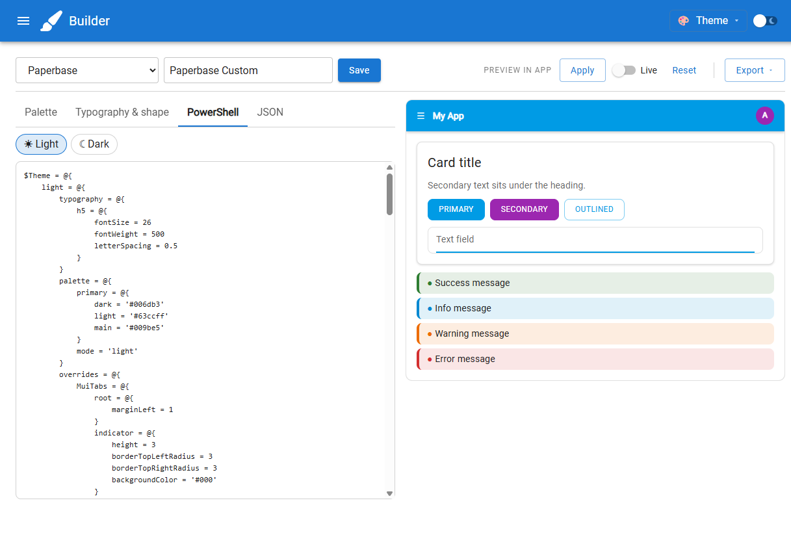

The **JSON** tab works both ways: view the theme as JSON, or paste in a theme (from MUI's docs, another app, or a colleague) and click **Load JSON**.

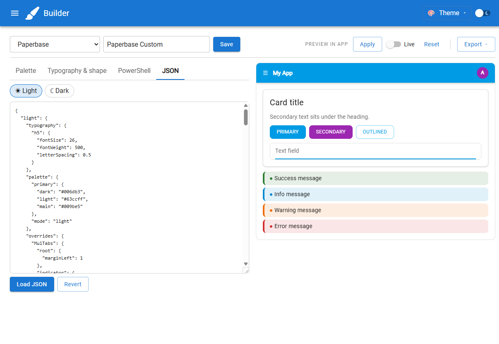

---

## The theme picker

Give your users a theme menu with one line:

```powershell
New-UDThemePicker -Themes (Get-UDChameleonTheme)
```

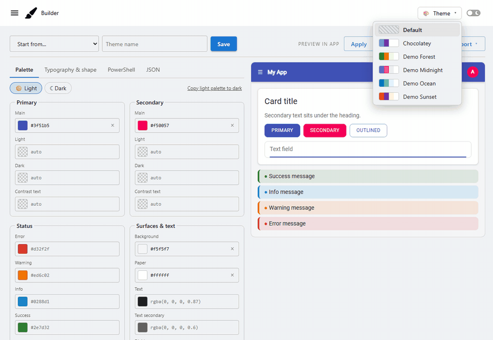

### See it in action

Switch between saved Chocolatey and PSU themes, then toggle light and dark mode—cards, inputs, buttons, and status alerts all follow the active theme.


| Light | Dark |
|---|---|
| 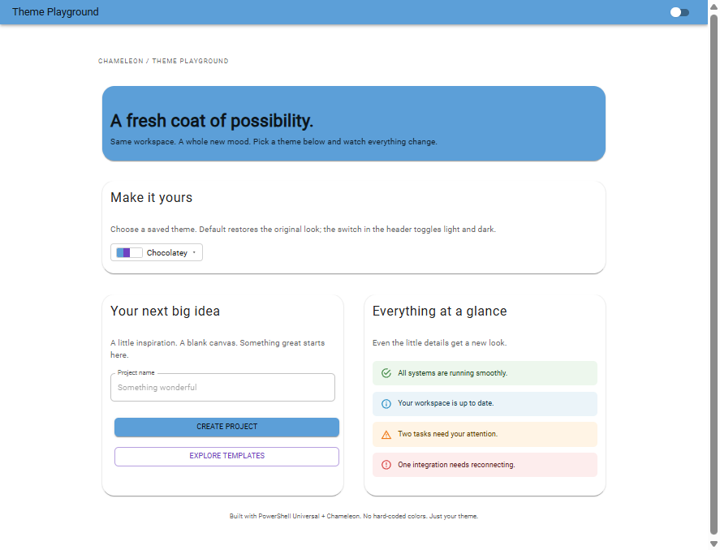 | 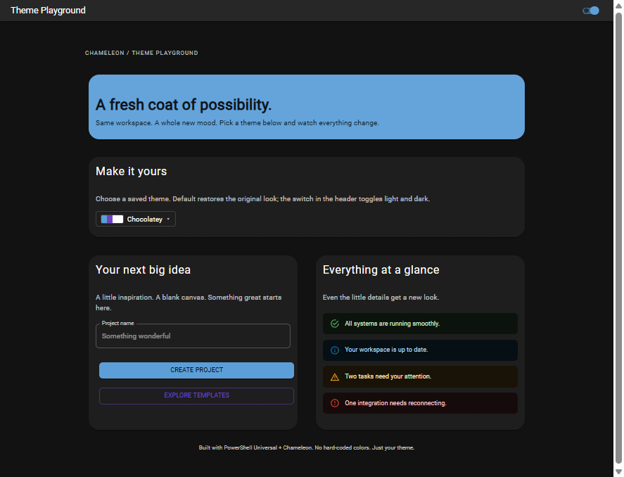 |

Choosing a theme:

- Applies it **instantly** to that user's session (no reload).
- Keeps their **light/dark** preference.
- Is **remembered** in their browser across visits.
- **Stays in sync** everywhere: every picker on the page (for example, the header menu and a settings-page grid) and in the user's other tabs updates immediately. Applying or resetting a theme from the builder clears the selection, since the app is no longer showing a picker theme.
- Can be undone with **Default**, which restores the app's own theme.

### Put it in the app header

The `menu` variant (the default) is designed for `-HeaderContent`:

```powershell
$App = @{
    Title = 'My App'
    HeaderContent = {
        New-UDThemePicker -Themes (Get-UDChameleonTheme)
    }
    Content = {
        New-UDTypography -Text 'Hello world'
    }
}
New-UDApp @App
```

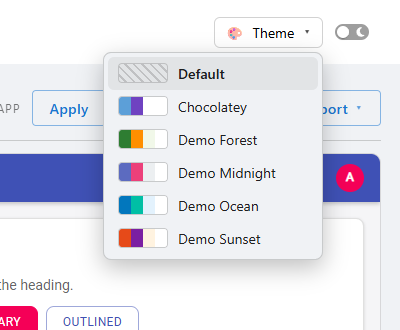

Each theme shows four swatches: primary, secondary, background, and paper.

The `menu` and `select` dropdowns group custom themes under **Saved** and built-in theme names under **Built-in**. Group headings are not selectable, empty groups are hidden, and **Default** stays above the groups when reset is enabled. The `grid` variant remains a flat set of cards.

The Chameleon app's header includes saved themes alongside the full list returned by `Get-UDTheme`, including terminal color schemes. New built-in names are discovered automatically. If a saved theme has the same name as a built-in, the saved theme takes precedence. This is separate from the builder's **Start from** list, which still offers the five curated MUI themes as built-in starting points.

### Variants

| `-Variant` | Looks like | Good for |
|---|---|---|
| `menu` *(default)* | A compact button with a dropdown | App headers and toolbars |
| `grid` | A row of swatch cards | Settings or profile pages |
| `select` | A native dropdown | Forms and tight spaces |

```powershell
$Picker = @{
    Themes = Get-UDChameleonTheme
    Variant = 'grid'
}
New-UDThemePicker @Picker
```

### What you can pass to `-Themes`

Mix and match any of these:

```powershell
# 1. Themes saved with the builder
New-UDThemePicker -Themes (Get-UDChameleonTheme)

# 2. Built-in theme names (anything Get-UDTheme lists, including terminal color schemes)
New-UDThemePicker -Themes 'AntDesign', 'Paperbase', 'Dracula'

# 3. Your own hashtables, with optional Description (tooltip) and Colors (custom swatches)
$Corporate = @{
    palette = @{
        primary = @{ main = '#0b5394' }
        secondary = @{ main = '#f1c232' }
    }
}
$Themes = @(
    @{ Name = 'Corporate'; Theme = $Corporate; Description = 'Brand colors' }
    'Paperbase'
)
New-UDThemePicker -Themes $Themes

# 4. A single hashtable of name = theme pairs
New-UDThemePicker -Themes @{ Corporate = $Corporate; Sand = (Get-UDTheme -Name 'Sand') }
```

### React to changes

`-OnChange` runs after a theme is applied. `$EventData` is the theme name, or an empty string when the user picks **Default**.

```powershell
$Picker = @{
    Themes = Get-UDChameleonTheme
    OnChange = {
        if ($EventData) {
            Show-UDToast -Message "Switched to $EventData"
        }
    }
}
New-UDThemePicker @Picker
```

### Switch themes from your own code

Use `Set-UDChameleonTheme` from any event handler (`-OnClick`, `-OnChange`, and so on):

```powershell
New-UDButton -Text 'Go dark and corporate' -OnClick {
    Set-UDChameleonTheme -Theme $Corporate -Variant 'dark'
}

New-UDButton -Text 'Back to default' -OnClick {
    Reset-UDTheme
}
```

---

## Using your theme in another app

Saved themes are plain hashtables, so you can make one the **default** theme of any app:

```powershell
Import-Module PowerShellUniversal.Component.Chameleon

$App = @{
    Title = 'My App'
    Theme = (Get-UDChameleonTheme -Name 'Corporate').Theme
    Content = {
        New-UDButton -Text 'Hello'
    }
}
New-UDApp @App
```

Or paste the output of **Export → Copy as PowerShell** straight into your script. That version has no dependency on Chameleon at all:

```powershell
$Theme = @{
    light = @{
        palette = @{
            mode = 'light'
            primary = @{
                main = '#5c9fd8'
                light = '#9dc5e8'
                dark = '#375f82'
            }
        }
        typography = @{
            fontFamily = "'PT Sans', sans-serif"
            fontSize = 16
        }
    }
    dark = @{
        palette = @{
            mode = 'dark'
            primary = @{
                main = '#5c9fd8'
            }
        }
    }
}

$App = @{
    Title = 'My App'
    Theme = $Theme
    Stylesheets = @('https://fonts.googleapis.com/css2?family=PT+Sans:wght@400;700&display=swap')
    Content = {
        New-UDButton -Text 'Hello'
    }
}
New-UDApp @App
```

> [!NOTE]
> To use `New-UDThemePicker`, `Set-UDChameleonTheme`, or `Get-UDChameleonTheme` in another app, that app must load the module, either with `Import-Module` in the app script or by setting `-Module 'PowerShellUniversal.Component.Chameleon'` on `New-PSUApp`.

---

## Saved Themes page

The Chameleon app's **Saved Themes** page lists everything in the store. Click a card to try the theme on the app, or use the table to **Edit** (opens it in the builder), **Copy PowerShell**, or **Delete**.

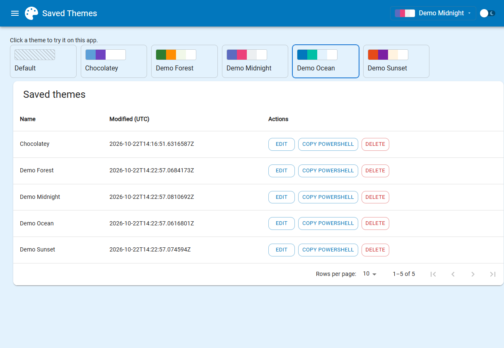

### Where themes are stored

Each theme is a JSON file in the theme store:

| | Path |
|---|---|
| Windows | `$env:ProgramData\Chameleon` (normally `C:\ProgramData\Chameleon`) |
| Linux | `$XDG_DATA_HOME/UniversalAutomation/Chameleon`, or `~/.local/share/UniversalAutomation/Chameleon` when XDG_DATA_HOME is unset or relative |
| macOS | `~/Library/Application Support/UniversalAutomation/Chameleon` |
| Override | Set `$env:PSU_CHAMELEON_PATH`, or pass `-Path` to the store commands |

An explicit `-Path` takes precedence over the environment variable. On Linux and macOS, `~` refers to the home directory of the account running PSU. For containers, set `PSU_CHAMELEON_PATH` to a persistent mounted directory so themes survive container replacement.

If you saved themes using the previous Windows default, move the JSON files from the `UniversalAutomation\Chameleon` folder under ProgramData to the new `Chameleon` folder, or set `PSU_CHAMELEON_PATH` to the previous location. Existing files are not moved automatically.

The PSU service account needs read access to use themes, and write access to save them. Because themes are just files, you can commit them to source control or copy them between servers.

---

## Command reference

All commands include comment-based help: `Get-Help New-UDThemePicker -Full`.

### Components

#### `New-UDThemeBuilder`

| Parameter | Type | Description |
|---|---|---|
| `-Id` | `string` | Component ID. Defaults to a new GUID. |
| `-Name` | `string` | Initial value of the name box. |
| `-Theme` | `object` | Starting theme: a hashtable, JSON string, `Get-UDChameleonTheme` result, or `Get-UDTheme -Name` output. |
| `-OnSave` | `Endpoint` | Replaces the default save behavior. `$EventData.name` is the name and `$EventData.theme` is a JSON string. |
| `-DisableSave` | `switch` | Hides the Save button. |
| `-DisableApply` | `switch` | Hides Apply, Live, and Reset. |
| `-HideStartFrom` | `switch` | Hides the Start from list. |

```powershell
# Save somewhere other than the theme store
$Builder = @{
    Id = 'builder'
    OnSave = {
        $Theme = ConvertTo-UDChameleonHashtable -InputObject $EventData.theme
        Set-PSUCache -Key "theme:$($EventData.name)" -Value $Theme
        Show-UDToast -Message "Saved $($EventData.name) to the cache"
    }
}
New-UDThemeBuilder @Builder
```

#### `New-UDThemePicker`

| Parameter | Type | Description |
|---|---|---|
| `-Id` | `string` | Component ID. Defaults to a new GUID. |
| `-Themes` | `object[]` | **Required.** See [What you can pass to `-Themes`](#what-you-can-pass-to--themes). |
| `-Variant` | `string` | `menu` (default), `grid`, or `select`. |
| `-Label` | `string` | Shown when no theme is selected. Defaults to `Theme`. |
| `-HideReset` | `switch` | Removes the **Default** option. |
| `-StorageKey` | `string` | Browser storage key for the remembered choice. Defaults to the app's base URL segment. Pickers that share a key stay in sync. Set it when two apps share a URL prefix, or to keep a picker independent. |
| `-OnChange` | `Endpoint` | Runs after a theme is applied. `$EventData` is the theme name. |

### Runtime

#### `Set-UDChameleonTheme`

Applies a theme to the current user's session. Call it from an event handler.

| Parameter | Description |
|---|---|
| `-Theme` | A hashtable, JSON string, or object. |
| `-Name` | A built-in theme name (validated against `Get-UDTheme`). |
| `-Variant` | `light` or `dark`. Defaults to the user's current mode. |

> Why not `Set-UDTheme`? PSU's `Set-UDTheme` switches the user to **light** mode unless you pass `-Variant`. `Set-UDChameleonTheme` detects and keeps the current mode.

### Theme store

| Command | Description |
|---|---|
| `Get-UDChameleonTheme [-Name <wildcard>] [-Path]` | Returns saved themes with `Name`, `Description`, `Modified`, `Theme` (hashtable), and `Path`. |
| `Save-UDChameleonTheme -Name -Theme [-Description] [-Path]` | Saves or overwrites a theme. Supports `-WhatIf`. Accepts pipeline input by property name. |
| `Remove-UDChameleonTheme -Name [-Path]` | Deletes a theme. Supports `-WhatIf` and `-Confirm`. |

```powershell
# Back up every theme to another server's store
Get-UDChameleonTheme | Save-UDChameleonTheme -Path '\\server2\c$\ProgramData\UniversalAutomation\Chameleon'

# Clean up experiments
Get-UDChameleonTheme -Name 'Test*' | Remove-UDChameleonTheme -Confirm:$false
```

### Helpers

| Command | Description |
|---|---|
| `ConvertTo-UDChameleonHashtable -InputObject` | Converts a JSON string, PSCustomObject, or dictionary into a hashtable. Handy inside `-OnSave` handlers. |
| `ConvertTo-UDChameleonSource -Source` | Resolves a `saved:<name>` or `builtin:<name>` reference to JSON. Used by the builder's Start from list. |
| `New-UDChameleonApp` | Builds the Chameleon app. Used by `.universal/dashboards.ps1`. |

---

## How it works

PSU apps are built on [MUI](https://mui.com/material-ui/customization/theming/). A theme is a hashtable that becomes an MUI theme object, optionally split into `light` and `dark` sections. PSU can also swap the theme for a single browser connection at runtime, and Chameleon builds on that.

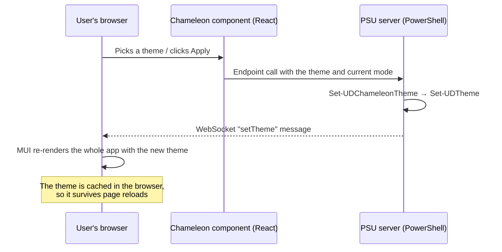

- **The builder** keeps the theme being edited in the browser. Only *Apply*, *Save*, *Reset*, and *Start from* talk to the server.
- **Start from** sends a request to the server, which looks up the theme and pushes it back to the builder with `Set-UDElement`.
- **The picker** sends saved and hashtable themes to the browser up front. Built-in themes are looked up on the server only when chosen, which keeps the page light.
- **Nothing is shared between users.** Applied themes live in each user's browser. Only *Save* writes to the server.

---

## Building from source

```
PowerShellUniversal.Component.Chameleon/
├── Components/                 # React source (bundled with webpack)
│   ├── index.js                # Registers ud-theme-builder and ud-theme-picker
│   ├── ThemeBuilder.jsx
│   ├── ThemePicker.jsx
│   ├── themeUtils.js           # Theme normalization, PowerShell codegen, color math
│   └── chameleon.css
├── PowerShellUniversal.Component.Chameleon/ # PowerShell module source
│   ├── PowerShellUniversal.Component.Chameleon.psd1
│   ├── PowerShellUniversal.Component.Chameleon.psm1
│   ├── public/                 # Exported PowerShell functions
│   ├── private/                # Internal helpers
│   ├── dashboards/             # The Chameleon app (App.ps1 + pages/)
│   └── .universal/dashboards.ps1 # Registers the app with PSU
├── docs/                       # README images; not published
├── output/                     # Generated, publishable module; ignored by Git
├── build.ps1                   # npm install + webpack + stage to output/
├── .babelrc
├── .gitignore
├── package.json
├── package-lock.json
└── webpack.config.js
```

```powershell
# Full build
.\build.ps1

# Rebuild the JS on every change while developing (writes to dist/)
npm run dev
```

After replacing the bundle on a server, **restart the app**. PSU registers the JavaScript asset when the module is imported.

> [!WARNING]
> In `webpack.config.js`, only `react` and `react-dom` may be externals. The `universal-dashboard` npm package **must be bundled**: PSU's `window.UniversalDashboard` global doesn't include `withComponentFeatures`, and marking the package external makes both components fail to load.

### Publishing to PowerShell Gallery

For each release:

1. Update `ModuleVersion` in [PowerShellUniversal.Component.Chameleon/PowerShellUniversal.Component.Chameleon.psd1](PowerShellUniversal.Component.Chameleon/PowerShellUniversal.Component.Chameleon.psd1). For example, use `1.1.0` for this release. The npm package version does not control the Gallery version.
2. Run the build from the repository root. It copies the updated manifest and compiled bundle into the output module.
3. Publish **only the staged module**, not the repository or the source module folder. The example uses `Publish-PSResource` from `Microsoft.PowerShell.PSResourceGet`:

```powershell
.\build.ps1

$Publish = @{
    Path = (Join-Path $PWD 'output/PowerShellUniversal.Component.Chameleon')
    Repository = 'PSGallery'
    ApiKey = $env:PSGALLERY_API_KEY
}
Publish-PSResource @Publish
```

Set `PSGALLERY_API_KEY` securely in your environment before publishing. Each Gallery release needs a new version; an already-published version cannot be overwritten. Do not edit the output manifest directly because the next build replaces it.

The build stages only the manifest, module loader, compiled JavaScript assets, PowerShell functions, app pages, and PSU registration. Git metadata, Node dependencies, React source, build configuration, and documentation stay outside the package. `.gitignore` controls Git tracking; it does **not** control what `Publish-PSResource` packages. The source module folder does not contain the compiled bundle until it is staged, so always publish from `output`.

---

## Troubleshooting

| Symptom | Cause and fix |
|---|---|
| A component shows **"One or more errors occurred / Unknown error occurred"** | The JavaScript bundle failed to load or register. Open the browser's developer console for the real error; PSU's logs won't show it. Most often the app wasn't restarted after the bundle was replaced. |
| The page returns **404** after deploying | Replacing module files stops the app. Restart it in the admin console. |
| **Apply**, the picker, or **Reset** does nothing | The module isn't loaded in the app's runspace. Add `Import-Module PowerShellUniversal.Component.Chameleon` to the app, or set `-Module` on `New-PSUApp`. |
| **Save** fails | The PSU service account can't write to the theme store. Grant access or set `$env:PSU_CHAMELEON_PATH` to a writable folder. |
| A font doesn't change | The font isn't installed for your users. Load it with `New-UDApp -Stylesheets`. |
| A saved theme isn't in the header picker | `-HeaderContent` runs when the page loads. Refresh the page. |
| The app is stuck on an old theme | The applied theme is cached in the browser. Pick **Default** in the picker or click **Reset** in the builder. |
